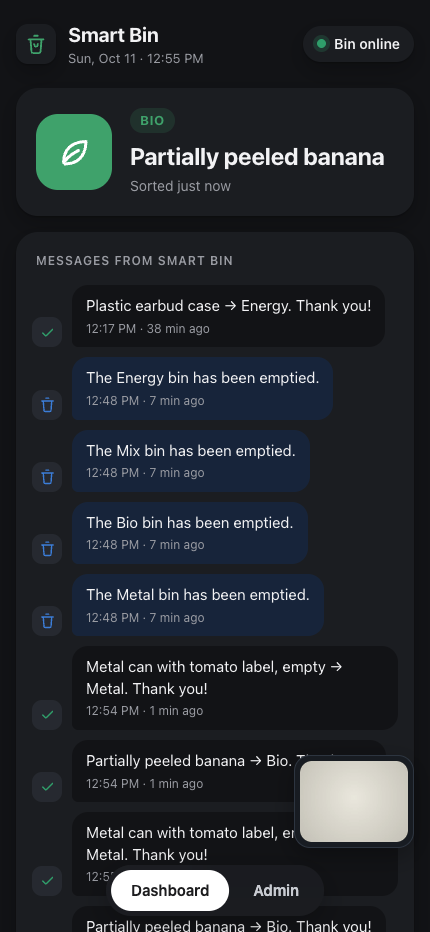
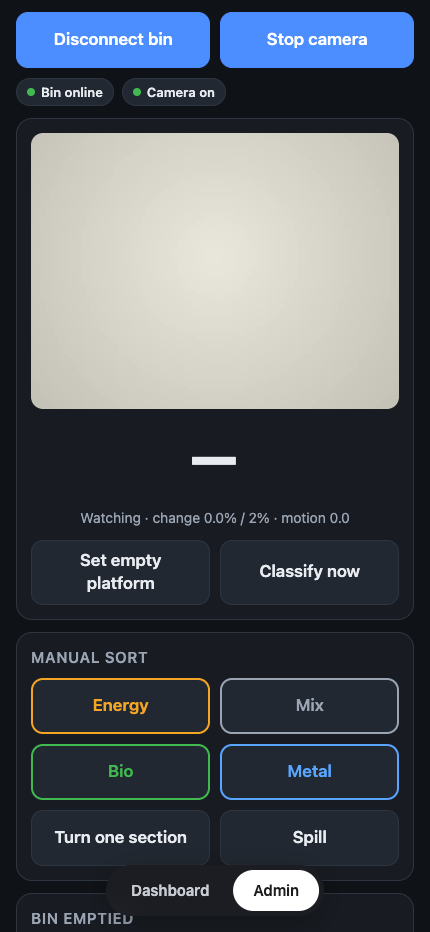
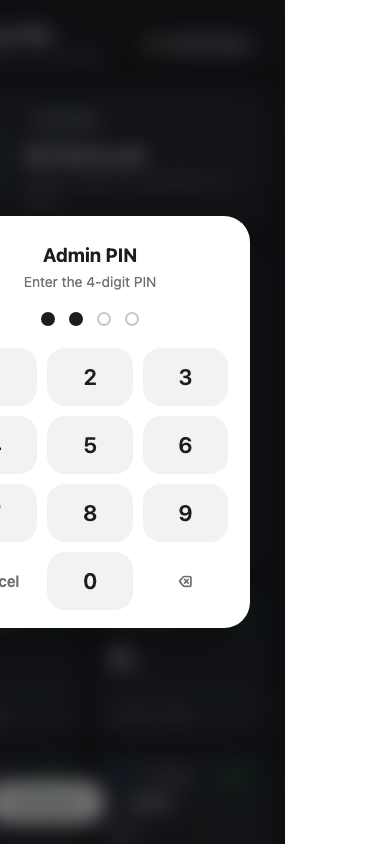
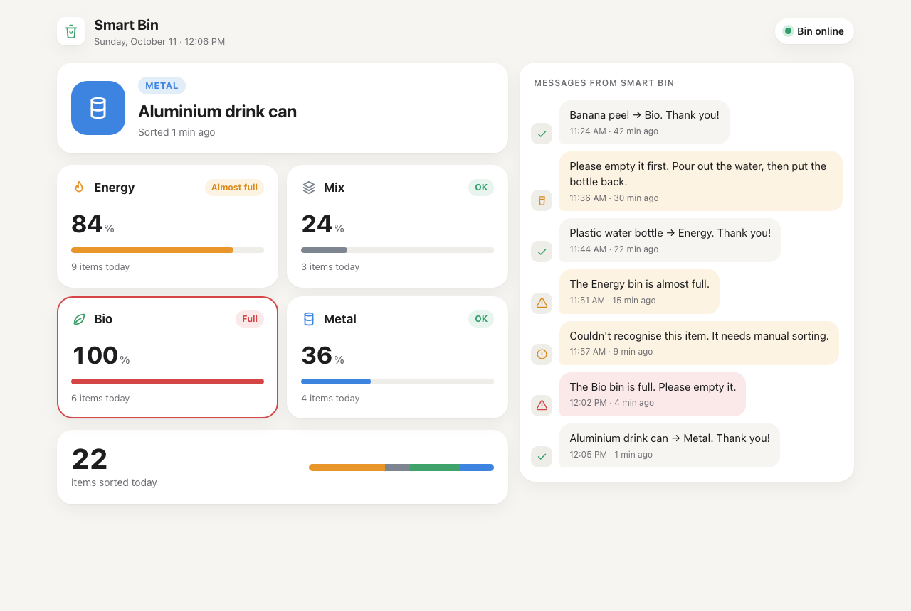
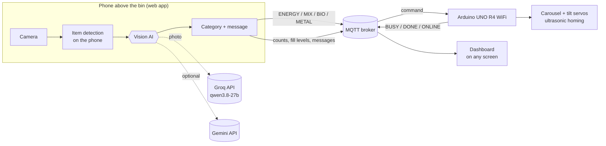

# Smart Bin ♻️

**A waste bin that looks at each item, decides where it belongs, and sorts it into the right compartment by itself.**

A phone camera above the bin's platform spots each new item. A vision AI identifies it and applies the Finnish household sorting rules, and an Arduino-driven carousel drops it into **Energy**, **Mix**, **Bio** or **Metal**. A live dashboard shows what was sorted, how full each compartment is, and messages such as *"Couldn't recognise this item, it needs manual sorting"* or *"The Bio bin is full, please empty it."*

| | |
|---|---|
| **Live app** | https://rahmanmdsazzadur.github.io/smart-bin/web/ |
| **Customer dashboard** | https://rahmanmdsazzadur.github.io/smart-bin/web/dashboard.html |
| **Demo video** | *add link* |
| **Team** | LPR DYNAMICS |
| **Event** | LUTES Deep Tech Hackathon 2026 |

---

## The problem

Sorting household waste correctly is harder than it looks. Is a coffee cup Energy or Bio? Does a ketchup bottle go in as it is? Small mistakes contaminate whole loads of recycling and biowaste, and the rules differ from country to country, which makes it especially hard for newcomers and visitors.

## Our solution

People just put the item on the platform. The bin does the rest:

1. **Notices the item** with the camera, without any button press.
2. **Identifies it** with a vision AI: what it is, what it is made of, and whether anything is still inside.
3. **Decides the compartment** using the Finnish household rules for Bio, Metal, Energy and Mix.
4. **Sorts it**: the carousel turns to the right compartment, the platform tilts, and the bin returns home.
5. **Explains itself** on the dashboard, and asks for help when needed:
   - an item that has to be emptied first (*"Please empty it first. Pour out the water, then put the bottle back."*),
   - an item it cannot recognise (*"It needs manual sorting."*),
   - a compartment that is almost full or full.

## Screenshots

| Customer dashboard | Admin panel | Admin PIN |
|---|---|---|
|  |  |  |



---

## How it works



| Step | What happens | Where |
|---|---|---|
| 1. Detect | The camera image is shrunk to 32×24 pixels and compared with the empty platform 5 times a second. When more than 2 % of the picture has changed and stayed still for 0.4 s, an item is there. | Phone |
| 2. Classify | One photo goes to the vision AI with the sorting rules. The AI replies in JSON: the item name, `SORT` or `PREPARE`, the category, and an instruction. | Groq (Gemini optional) |
| 3. Sort | The category is sent to the bin over MQTT. The Arduino answers `BUSY`, turns the carousel, tilts the platform, returns home and answers `DONE`. | Arduino |
| 4. Report | Counts, estimated fill levels and messages are published as one retained message, so every dashboard shows the same live numbers, even one opened later. | Broker → dashboards |

### Why the phone and the bin talk through MQTT

The web app must run on an `https://` page, because browsers only allow the camera there. The same browsers block an `https://` page from talking to a plain `http://` device on the local network. So the phone and the Arduino both connect *outwards* to an MQTT broker over encrypted connections (WebSocket over TLS for the phone, TLS for the Arduino). This works on home Wi-Fi, a phone hotspot or any other network, with no port forwarding.

---

## Features

**Sorting**
- Hands-free: items are detected automatically; each item is classified once.
- The AI names the item before choosing the bin, which makes its choice more reliable, and shows that name on screen.
- **"Empty me first"**: full bottles, sauce bottles, jars with metal lids or boxes with food are not sorted; the person gets a short instruction instead.
- Manual sort buttons for anything the AI is unsure about.

**AI**
- Groq vision model (`qwen/qwen3.8-27b`), typically **0.5–1.1 s** per item.
- Optional Gemini models in a chain (each model has its own free allowance), with automatic fallback to Groq when a quota runs out.
- Stays inside the free plan's per-minute limit by counting its own usage and waiting when needed.

**Dashboard and admin**
- One app with a **Dashboard | Admin** switch; a standalone customer dashboard with no admin access.
- Live status, last item, fill level and today's count per compartment, and a message feed.
- Admin protected by a **PIN**; it **locks itself whenever the app is left** (another app or tab, screen locked).
- Works on phones, tablets and big screens, in light and dark mode. Installable on the home screen.
- **Automatic updates:** open apps notice a new version on GitHub and reload themselves, never in the middle of a sort.

**Bin**
- 4-compartment carousel driven by a continuous-rotation servo; two servos tilt the platform to spill the item.
- Ultrasonic homing sensor to find the start position.
- Online/offline status reported through the broker (MQTT last will).

---

## Hardware

| Part | Purpose |
|---|---|
| Arduino UNO R4 WiFi | Controls the motors and connects to the broker over Wi-Fi |
| Continuous-rotation servo (D6) | Turns the 4-section carousel |
| 2 × continuous-rotation servos (D7, D5) | Tilt the platform to spill the item |
| HC-SR04 ultrasonic sensor (D10 trig, D9 echo) | Homing: finds the start position |
| 6 V battery pack | Powers the servos (shared ground with the Arduino) |
| Smartphone (iPhone or Android) | Camera, AI requests and on-site screen |

## Repository structure

```
web/index.html                       The app: camera, detection, AI, bin control, dashboard + admin
web/dashboard.html                   Customer dashboard (also embedded in the app)
web/version.json                     Latest version number, for automatic updates
arduino/smart_bin/smart_bin.ino      The team's original, tested motor sketch (USB serial)
arduino/smart_bin_wifi/              Wi-Fi version: original motor code + MQTT
.githooks/pre-commit                 Stamps the version number on every commit
docs/SETUP.md                        Full setup guide
docs/images/                         Screenshots
```

The web app is plain HTML, CSS and JavaScript in single files, with **no frameworks, no build step and no external libraries**. It even includes its own small MQTT client. It is hosted for free on GitHub Pages.

---

## Testing

### End-to-end simulation (no hardware)

We tested the complete system with simulated hardware:
- a **fake camera** feeding a prepared video (empty platform → tin can → empty → banana → empty),
- a **fake bin** that joins the broker and answers exactly like the Arduino,
- the **real web app** in an automated Chrome, driven like a user,
- the **real AI**.

**Result: 21 of 21 checks passed.**

| Checked | Result |
|---|---|
| App opens locked on the dashboard; wrong PIN refused; correct PIN opens admin | ✅ |
| Admin locks when the app is left and asks for the PIN again | ✅ |
| Bin goes online through the broker | ✅ |
| Empty platform saved automatically; both items detected automatically | ✅ |
| AI: "metal can with tomato label, empty" → **METAL** (0.5 s); "partially peeled banana" → **BIO** (1.1 s) | ✅ |
| Command reaches the bin; bin replies `BUSY` → `DONE` | ✅ |
| Dashboard updates live: last item, counts, messages, online status | ✅ |
| Camera keeps running while the dashboard is shown | ✅ |
| No JavaScript errors | ✅ |

The simulation found two bugs, which we fixed:
1. **Small items were missed.** Detection averaged the difference over the whole picture, so a small item never reached the threshold. It now measures the share of the picture that changed clearly.
2. A "Camera off" label stayed on top of the live video.

### Other checks
- Both Arduino sketches compile for the UNO R4 WiFi (27 % of program storage).
- The original motor functions (`one_section_turn`, `spill_trash`, `Homing`) were verified to be copied unchanged into the Wi-Fi sketch.
- MQTT packet encoding and parsing was unit-tested, including packets split across WebSocket messages.
- The fallback chain (Gemini models → Groq) was tested with simulated quota errors.

---

## Try it

- **Without hardware:** open the [live app](https://rahmanmdsazzadur.github.io/smart-bin/web/) on a phone or laptop. The dashboard opens first. The admin panel (camera and AI) needs the PIN, which we can share with the assessors on request.
- **With hardware:** follow the step-by-step [setup guide](docs/SETUP.md): wiring, uploading the sketch, hosting the app and calibration.

---

## Security and privacy

- **No photos are stored.** Each photo goes to the AI service once to be classified and is not saved by the app.
- **Admin PIN:** only a SHA-256 hash of the PIN is in the code, and admin locks itself whenever the app is left.
- **Wi-Fi passwords** stay in `arduino_secrets.h`, which is excluded from the repository.
- **Known limitation:** to make the demo work on any phone without setup, the free-tier Groq key and the MQTT topic name are included in the public web app. Someone reading the code could use up the free AI quota or send commands to the bin. For a real deployment, the next step is a small server that keeps the AI key private and authenticates the bin's commands (see below).

## Limitations and future work

- **Fill level is estimated** from the number of items (25 per compartment). An ultrasonic fill sensor per compartment would measure it.
- **Homing happens once at power-up**, so small timing errors could add up over many sorts. Re-homing after every sort would remove this.
- **Keys in the browser:** move AI calls behind a small server (for example a free serverless function) and use a private MQTT broker with logins.
- **Rules are Finnish household rules.** They are written as plain text in the prompt, so they can be adapted to another country without code changes.
- **More compartments** (plastic, paper, glass) would match real Finnish recycling points more closely.

## Team

**LPR DYNAMICS**

- Denilson Fernandes
- Shoaib Iqbal Sirazi
- Abu Saimoom
- Htin Lwin

## Acknowledgements

- [Groq](https://groq.com) and [Google Gemini](https://ai.google.dev) for the vision AI APIs
- [HiveMQ](https://www.hivemq.com/mqtt/public-mqtt-broker/) for the free public MQTT broker
- [Arduino](https://www.arduino.cc) for the UNO R4 WiFi, `ArduinoMqttClient` and `Servo` libraries
- Built with help from Claude Code (Anthropic)
